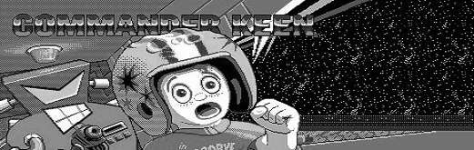

# Commander Keen for Analogue Pocket

Commander Keen 1–6 and Keen Dreams in one openFPGA core, maintained by **RetroDriven**. Core ID: `RetroDriven.CommanderKeen`. Pocket title: **Commander Keen**. Default presentation: **5:4**.

Supply the original DOS game files. Public downloads exclude original executables/resources, saves and the converted `keenpack.bin`.

See [Where to obtain the games](GETTING_THE_GAMES.md) for Steam, GOG, shareware and original-copy options, including Keen Dreams and version compatibility.

## Install on Pocket (Windows)

1. Extract **RetroDriven.CommanderKeen-v1.0.0.zip** into the Pocket SD root, merging **Cores, Assets, Platforms and Presets**.
2. Download and run **RetroDriven.CommanderKeen-GamePrep-v1.0.0.exe** from the Releases page
3. Click **Add folder...** to select your installed DOS episodes or a parent containing them. Add other locations as needed. For Steam Dreams, choose **DOS/EGA**. See [REQUIRED_FILES.md](REQUIRED_FILES.md) or the tool's **Required DOS files** button.
4. Choose **Prepared files on this PC**. The default is **Documents/CommanderKeen-Prepared**.
5. Optionally choose the **Pocket SD root** where you installed the core. Leave this blank to prepare files without writing to the card.
6. Click **Prepare game data**. The tool validates the files, generates **Assets/keen/common/keenpack.bin** inside your prepared folder, checks the pack and optionally installs it to the SD.
7. Wait for success. If you skipped the SD field, merge the prepared **Assets** folder into the SD root. Safely eject, then launch **openFPGA → Commander Keen** and select an episode.

Include **all episodes you want available** each time: a new pack replaces the previous pack rather than merging it. Only episodes included in the pack can launch. Logs are stored in **%LOCALAPPDATA%/RetroDriven/CommanderKeenGamePrep-v1/GamePrep.log**.

## Episodes

| Pocket selection | Data folder | Engine/reference |
| --- | --- | --- |
| Keen 1 - Marooned on Mars | KEEN1 | RetroDriven; Chocolate Keen reference |
| Keen 2 - The Earth Explodes | KEEN2 | RetroDriven; Chocolate Keen reference |
| Keen 3 - Keen Must Die! | KEEN3 | RetroDriven; Chocolate Keen reference |
| Keen 4 - Secret of the Oracle | KEEN4 | Omnispeak |
| Keen 5 - The Armageddon Machine | KEEN5 | Omnispeak |
| Keen 6 - Aliens Ate My Babysitter! | KEEN6 | Omnispeak |
| Keen Dreams | KEENDREAMS | ReflectionHLE |

Use the supplied JSON selectors. All episodes share the core and pack, with independent save namespaces. Do not exchange save files between episodes.

## Quality-of-life features

| Feature | What it adds |
| --- | --- |
| Enhanced HUD | Always-visible score, lives and ammo; contextual keys/gems and episode-specific progress. Relevant key colors appear in levels and are hidden on the world map. X still opens the full DOS status panel. |
| Manual saves during play | Save from normal gameplay or the world map through Start → Save Game. Occupied slots use an overwrite confirmation. |
| Automatic checkpoints | **On / Prompt / Off** after level completion/map return, with themed prompts and readable save notifications. Autosave stays separate from manual saves. |
| View Mode | **Enhanced / Original** independently for each episode. Enhanced uses a 240-line canvas where supported; Original preserves the 200-line view. Fixed DOS artwork keeps its native proportions with matching margins. |
| Core Volume | **100% / 75% / 50% / 25% / Mute**, independent of the Pocket hardware volume. |
| Pocket controls and menus | A jump, B shoot/throw, X status, Y pogo, Start menu and Select help. Hold Up/Down to repeat in supported menus and scrolling text. |
| DOS presentation | Original artwork, episode menus, help, status screens and attract/demo sequences, with Pocket button prompts. |
| Standalone Windows GamePrep | Add multiple DOS folders, generate and check one pack, and optionally install it to the SD through a graphical app. |

Keen 1–3 had no always-visible DOS HUD: their optional overlay is a port addition. Keen 4–6 and Dreams retain their native scorebox, with contextual additions in Enhanced mode. Enhanced HUD hides irrelevant counters and may look identical to the basic HUD when a level has no extra information to show. See [CONTROLS.md](CONTROLS.md) for each episode's additions and settings.

## Controls and defaults

**A:** Jump/confirm. **B:** Shoot or throw/back. **X:** DOS status panel. **Y:** Pogo in Keen 1–6; Dreams has no pogo. **Start:** Menu. **Select:** Help where available. D-pad moves/navigates; Up interacts with Galaxy doors/switches.

Fresh-install defaults are **View Mode Enhanced**, **HUD Enhanced**, **Auto Save On** and **Core Volume 100%**. View Mode is above HUD in Core Settings. The global Pocket aspect is **5:4**. Per-episode settings persist; updating preserves existing choices rather than resetting them to defaults.

The port uses the original 16-color EGA artwork. Enhanced View Mode provides more screen coverage where supported; it does not introduce VGA/256-color replacement graphics.

## Saves and updates

Use Start → Save/Load for manual saves. Auto Save On writes a verified checkpoint after level completion/map return. Prompt asks first; Off preserves the previous autosave. Autosave is separate from manual slots. Preserve **Saves/keen/** and **Settings/RetroDriven.CommanderKeen/** when updating. Native Pocket Memories/save states are unsupported.

## Source and credits

See [CREDITS.md](CREDITS.md), [THIRD_PARTY_NOTICES.md](THIRD_PARTY_NOTICES.md) and [LICENSE](LICENSE). Original games/artwork retain their owners' rights. This is an independent community port, not an official Analogue or Commander Keen release.
